# Reproduction proof — CAFIN calcium-transient study

Generated automatically from `results/results.json`; every number below is computed from per-cell ΔF/F₀ᵢ outputs. Each F₀ᵢ is the mean of cell i's own n = min(10, max(3, T // 3)) lowest finite, background-corrected frames (floor 1); ΔF/F₀ᵢ(t) = (Fₜ,ᵢ − F₀ᵢ) / F₀ᵢ. Re-running normalization, `reproduce.py`, and `generate_paper.py` regenerates this file identically (fixed seed).

Original microscopy TIFFs were located in a local data folder outside the repository; they are not bundled with this checkout. The paper-style microscopy panels and three activity figures were regenerated from local TIFFs, saved cell masks, and corrected traces in this run. This run used LATA1 raw fluorescence CSVs previously extracted from TIFFs; it did not rerun registration, segmentation, or fluorescence extraction. The LATA2 fields used stored raw per-cell fluorescence CSVs. All four fields were renormalized in this run.

The stored LATA2 baseline trace table lacked frame-0 values. A separately checked source-TIFF row restores them without changing the original CSV; see source_repairs/lata2_before_frame0_provenance.json.

The reference manuscript's six-paired-trial result is not reproduced here. A separate six-trial local audit is exploratory because processing methods and provenance differ; this report presents two trial pairs.

## 1. Fields analyzed

| Field | cells | frames | active % | median peak ΔF/F₀ᵢ | heterogeneity CV | sync r | provenance |
|---|---|---|---|---|---|---|---|
| trial1 Baseline | 484 | 31 | 99.6% | 3.40 | 0.63 | 0.245 | each cell's own 10 lowest frames (F0i) from raw-TIFF-regenerated traces |
| trial1 Latrunculin | 517 | 90 | 100.0% | 7.63 | 0.82 | 0.532 | each cell's own 10 lowest frames (F0i) from raw-TIFF-regenerated traces |
| trial2 Baseline | 479 | 31 | 100.0% | 3.04 | 0.67 | 0.221 | each cell's own 10 lowest frames (F0i) from stored pipeline traces; frame 0 recovered from source TIFF |
| trial2 Latrunculin | 452 | 55 | 100.0% | 2.45 | 1.26 | 0.353 | each cell's own 10 lowest frames (F0i) from stored pipeline traces |

## 2. Statistical tests (baseline vs Latrunculin, pooled cells)

Normality via Shapiro–Wilk; Welch t-test if both groups normal, else Mann–Whitney U.

| Metric | median base | median Lat | Shapiro p (base/Lat) | test | p-value | effect |
|---|---|---|---|---|---|---|
| Peak ΔF/F₀ᵢ | 3.156 | 4.164 | <1e-4/<1e-4 | Mann-Whitney U | 1.18e-27 | 0.29 |
| Mean ΔF/F₀ᵢ | 0.803 | 1.666 | <1e-4/<1e-4 | Mann-Whitney U | 5.44e-127 | 0.63 |
| Transients/frame | 0.097 | 0.200 | <1e-4/<1e-4 | Mann-Whitney U | 1.56e-215 | 0.82 |
| Transient AUC | 0.496 | 1.235 | <1e-4/<1e-4 | Mann-Whitney U | 1.66e-100 | 0.56 |
| Pairwise correlation r | 0.221 | 0.486 | <1e-4/<1e-4 | Mann-Whitney U | <1e-300 | 0.36 |

## 3. Manuscript claims vs reproduced result

| Manuscript claim | Reproduced? | Evidence |
|---|---|---|
| Increased spatial heterogeneity | ✅ | CV 0.65 → 1.04 (both trials) |
| Altered temporal synchronization | ✅ | mean pairwise r 0.23 → 0.44 across two trial pairs; pooled cell-pair p-values are descriptive |
| Increased peak amplitude | Mixed | Trial 1 median 3.40 → 7.63; trial 2 3.04 → 2.45 |
| Distinct Ca²⁺ propagation/coordination | Partial | Correlation-versus-distance supports a coordination difference; propagation was not directly measured |

## 4. Figures (numbered as in the paper)

**Figure 1 — Image & data processing pipeline**

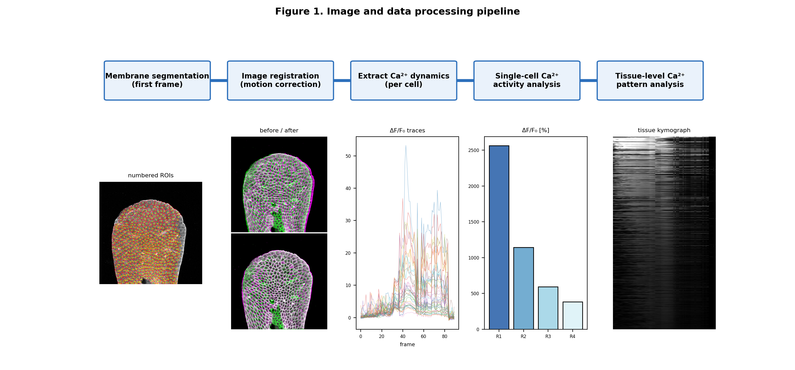

**Figure 2 — Registration overlay, baseline (green/magenta)**

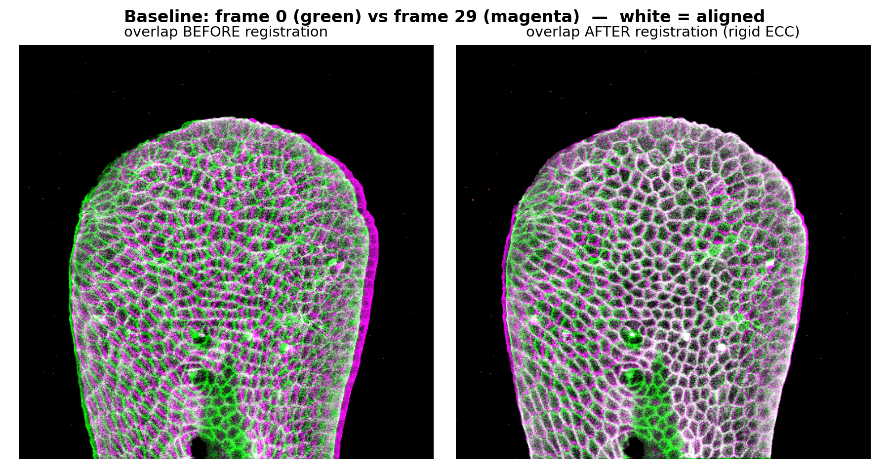

**Figure 3 — Registration: rigid vs elastic, after drug**

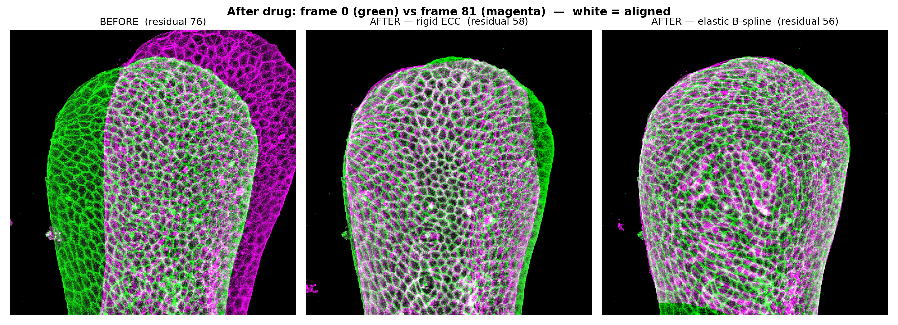

**Figure 4 — Membrane | Registered | +Mask | Calcium+Mask**

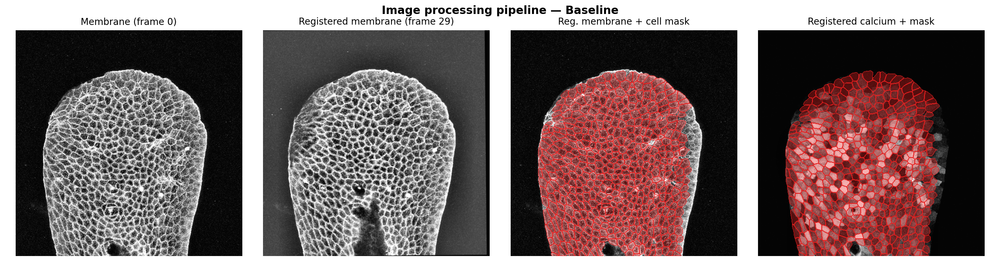

**Figure 5 — Cell mask with numbered ROIs**

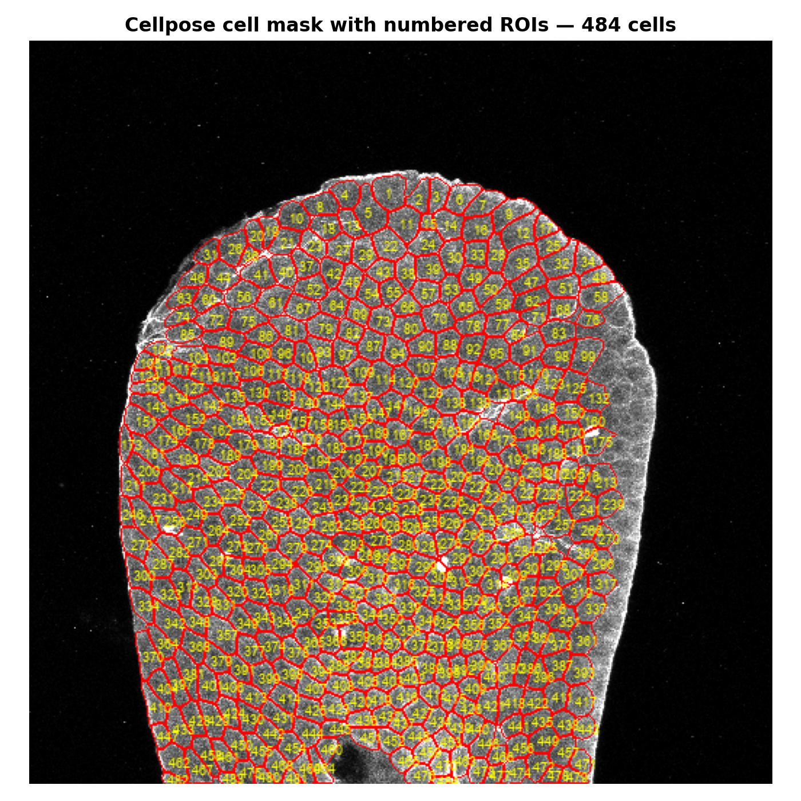

**Figure 6 — Background reference regions (3 boxes)**

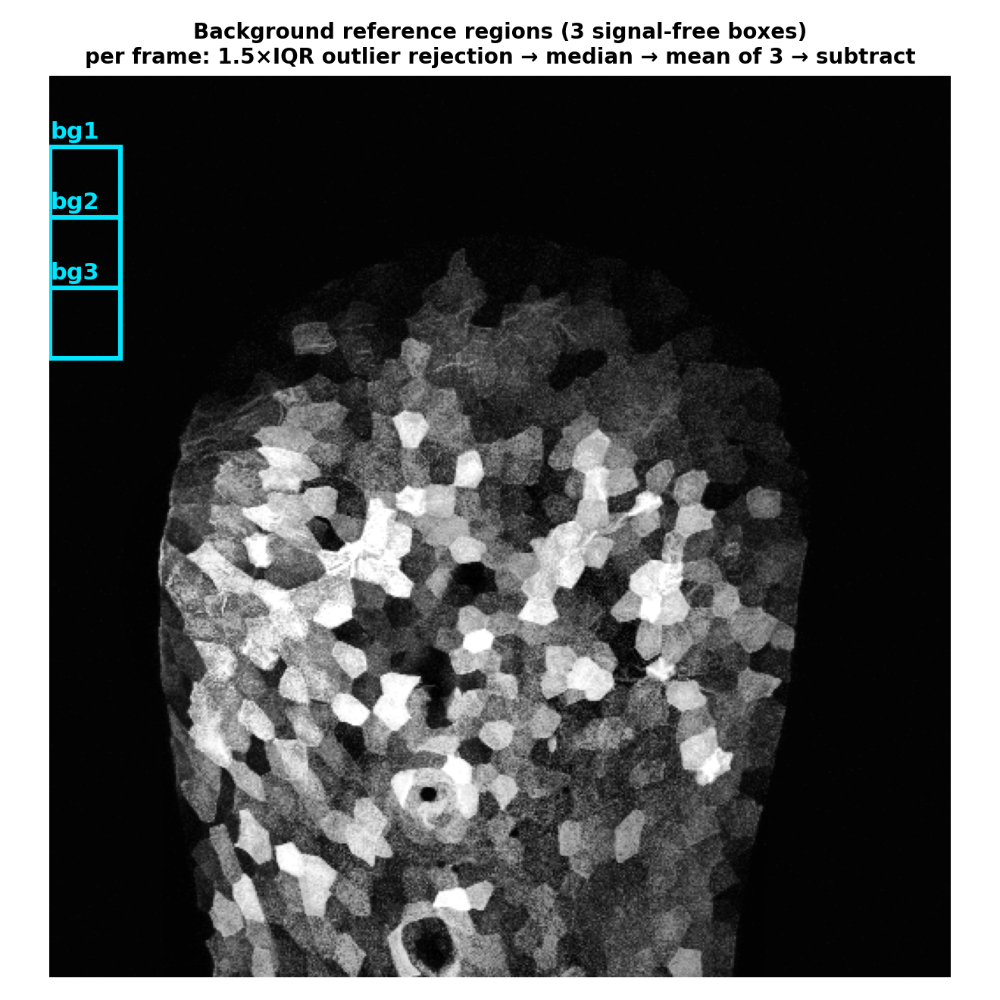

**Figure 7 — ROI selection (cells intersecting the ROI)**

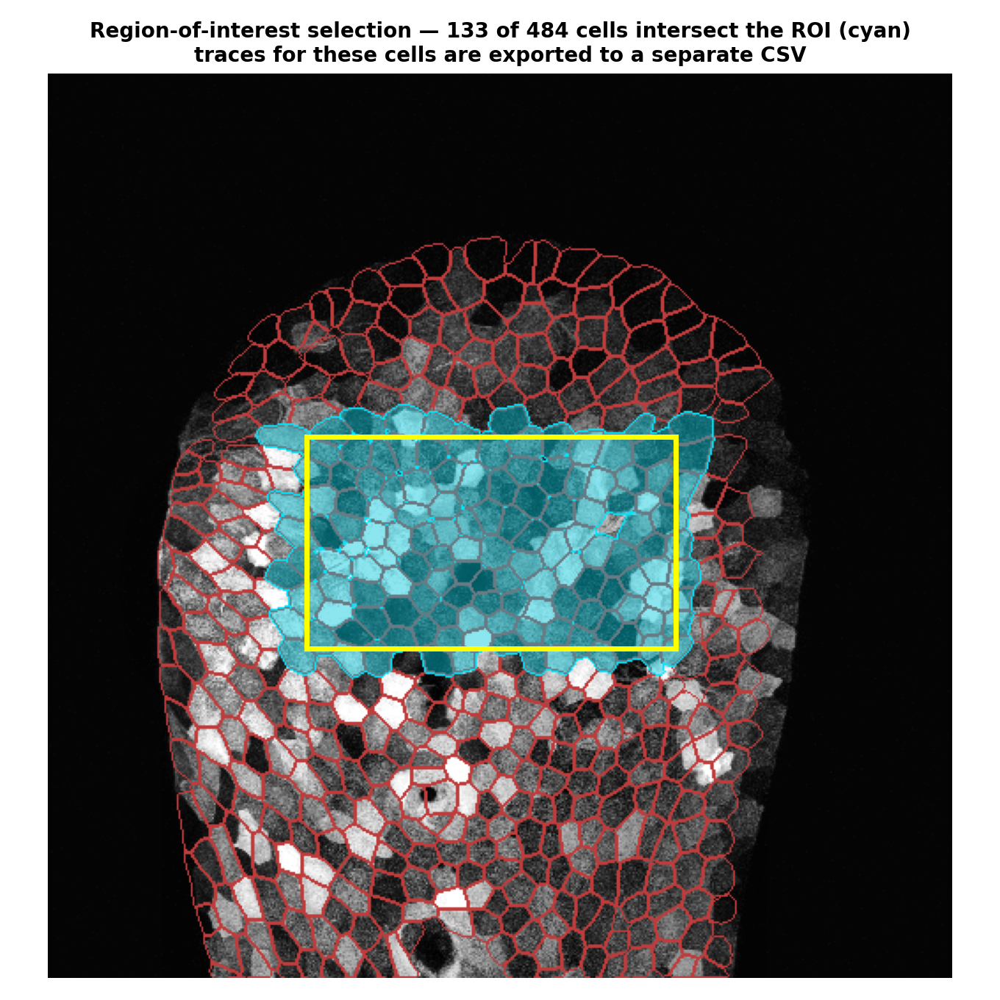

**Figure 8 — Single-cell ΔF/F₀ᵢ traces**

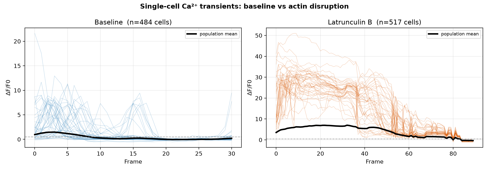

**Figure 9 — Active-cell fraction per frame**

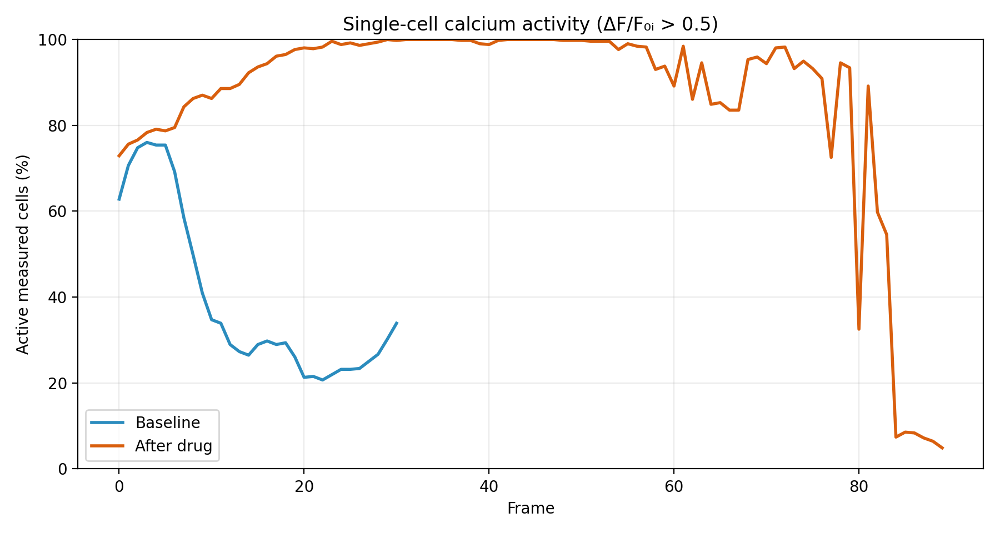

**Figure 10 — Single-cell metric comparison + p-values**

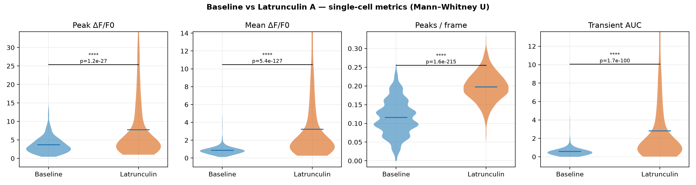

**Figure 11 — Regional ΔF/F₀ᵢ (R1–R4)**

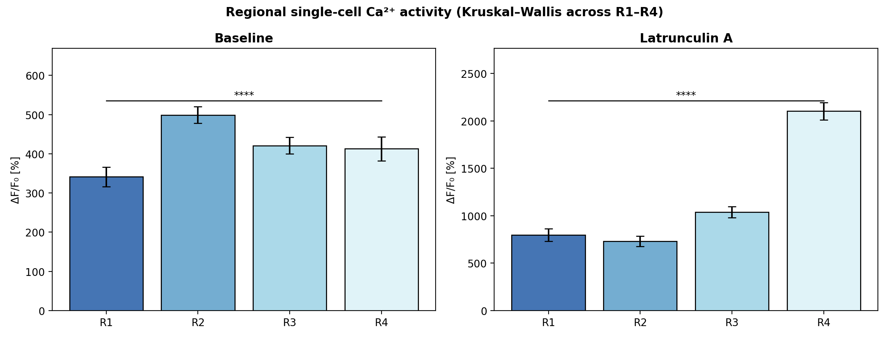

**Figure 12 — Ca²⁺ transient event raster**

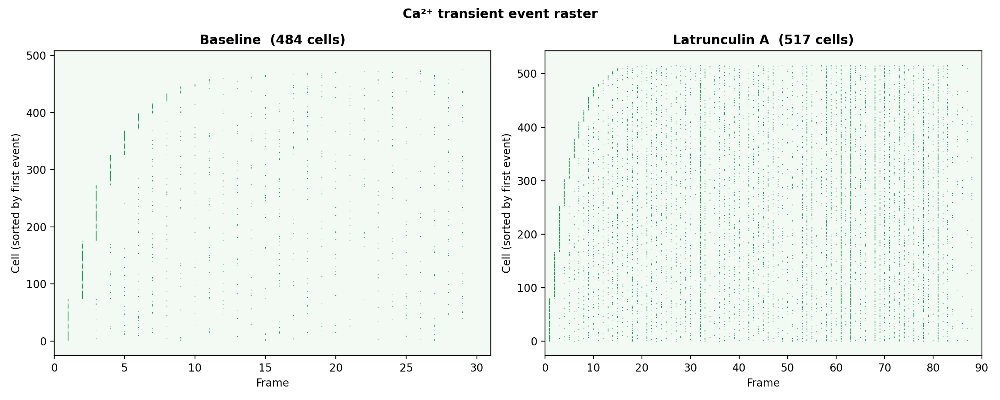

**Figure 13 — Tissue activity heatmaps**

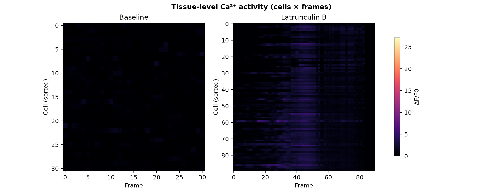

**Figure 14 — Per-cell peak activity map**

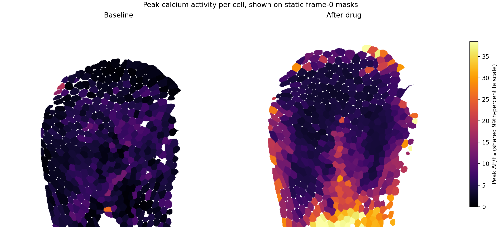

**Figure 15 — Activity maps at three timepoints**

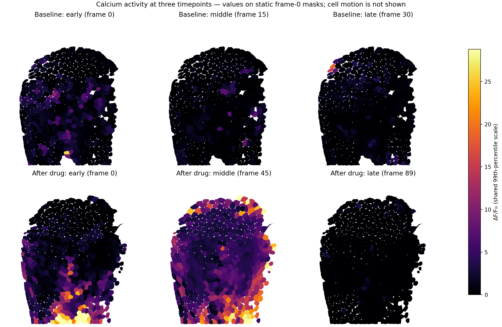

**Figure 16 — Tissue pattern metrics**

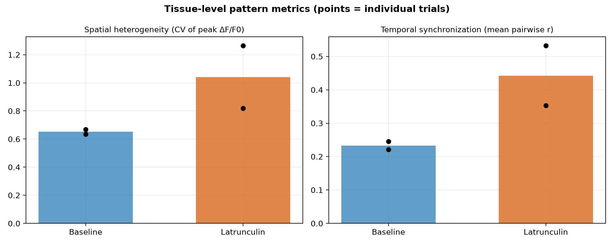

**Figure 17 — Spatial coordination vs distance**

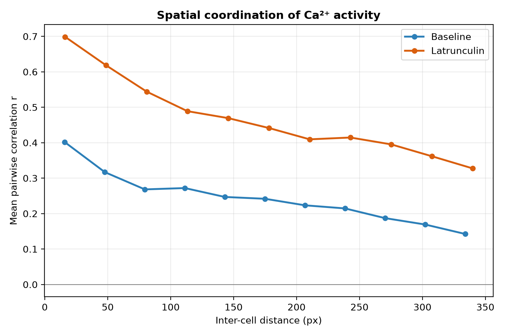

**Figure 18 — Time-dependence**

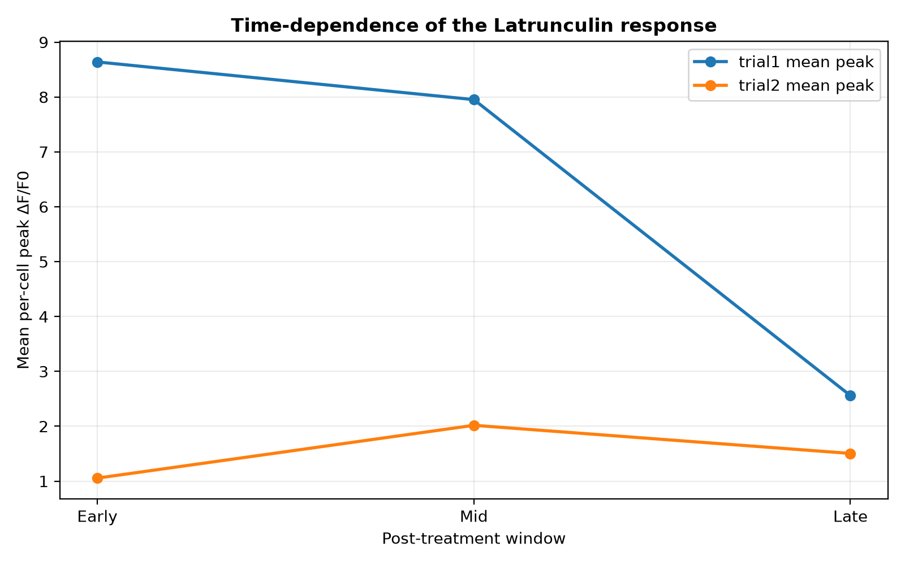
